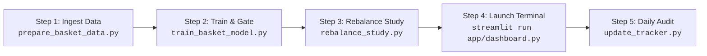

# MarketMind Quantitative Terminal

MarketMind is an institutional-grade algorithmic portfolio construction and quantitative equity analysis platform designed for Indian equities (NSE Nifty 500) and benchmark indices. It combines cross-sectional factor ranking, walk-forward machine learning validation, intraday direction forecasting, automated liquidity screening, risk-budgeted position sizing, and live paper-trading tracking into a high-performance Streamlit terminal.

---

## Technology Stack

| Layer | Technologies | Purpose |
| :--- | :--- | :--- |
| **Core Language** | Python 3.11+ / 3.14 | Core execution, vectorized mathematics, and data processing |
| **User Interface** | Streamlit, Plotly, HTML5/CSS3 | Reactive analytics dashboard, interactive charting, investor terminal |
| **Machine Learning** | Scikit-Learn | Logistic Regression, HistGradientBoosting, MLP Neural Nets, calibration |
| **Data & Vectorization** | Pandas, NumPy, PyArrow | High-throughput matrix computations and vectorized indicator engines |
| **Storage & Caching** | Apache Parquet | High-compression columnar storage for 10-year daily OHLCV tick data |
| **Market Data Ingestion** | NSE India Archives, Yahoo Finance (`yfinance`) | Constituent lists, live pricing, and benchmark index history (`^CRSLDX`) |

---

## System Architecture

```mermaid
flowchart TD
    subgraph Ingestion["1. Data Ingestion & Universe Pipeline"]
        NSE["NSE India Archives (ind_nifty500list.csv)"] --> Sym["499 Constituent Tickers + Benchmark (^CRSLDX)"]
        Sym --> Cache[("Local Parquet Cache: 10Y Daily OHLCV")]
        Cache --> LiqFilter["Liquidity Screening: ADTV >= INR 5 Crore/Day"]
    end

    subgraph Features["2. Anti-Leakage Feature Engine"]
        LiqFilter --> PastOnly["Past-Only Historical Windows (T <= t)"]
        PastOnly --> Calc["Compute: RS (1M/3M/6M), Mom (3M/6M/9M/12M/12-1), ATR%, Beta, Sharpe, Dist 52W High"]
        Calc --> Panel[("Monthly Panel Dataset: 43,169 rows, 107 Months")]
    end

    subgraph Validation["3. Walk-Forward Tournament & Gating"]
        Panel --> ChronoSplit{"Chronological Split"}
        ChronoSplit --> Train["Train Split (65 Months)"]
        ChronoSplit --> Val["Validation Split (24 Months)"]
        ChronoSplit --> Holdout["Final Holdout Split (24 Months)"]
        Train --> Models["ML Tournament: Logistic, HistGB, MLP"]
        Val --> Gate{"Does ML Beat Momentum after 0.5% Costs?"}
        Gate -->|No (Empirical Finding)| DefaultEngine["Deploy Robust Baseline: Mom_12_1"]
        Gate -->|Yes| MLEngine["Deploy Calibrated ML Model"]
    end

    subgraph Portfolio["4. Portfolio Construction & Sizing"]
        DefaultEngine --> Top15["Rank & Select Top 15 Liquid Stocks"]
        Top15 --> Buffer["Top-30 Retention Buffer (Turnover Control)"]
        Buffer --> Sizing["Equal-Weight Allocation (~6.67% per Stock)"]
        Sizing --> RegimeCheck{"Is Benchmark < 200 SMA?"}
        RegimeCheck -->|Yes| RegimeAlloc["Allocate 50% Cash Reserve + 50% Equity"]
        RegimeCheck -->|No| FullAlloc["Allocate 100% Equity"]
    end

    subgraph Interface["5. Execution & Continuous Monitoring"]
        RegimeAlloc --> Dashboard["Streamlit Production Dashboard"]
        FullAlloc --> Dashboard
        Dashboard --> InvestorMode["Investor Mode: Actionable Jargon-Free Plan"]
        Dashboard --> QuantExpander["Quant Mode: Monte Carlo (5,000 runs) & Deep Analytics"]
        Dashboard --> Monitor["Daily/Weekly Risk Alerts (Stop 2xATR, Crash 7%, 200 SMA)"]
        Dashboard --> PaperLedger["Paper Trading Ledger & Intraday Accuracy Tracker"]
    end
```

---

## Core Systems & Capabilities

### 1. Nifty 500 Basket Builder
An end-to-end quantitative portfolio engine that scans the liquid Nifty 500 universe and builds an actionable 15-stock equity basket:
- **Investor Mode**: Clean, plain-language interface designed for retail and institutional allocators. Provides exact share quantities, investment budgets in INR, entry timing guidelines, exact stop-loss exit prices, and next monthly review dates.
- **Timing & Tranche Execution**: Suggests single-tranche deployment during broad market uptrends (Nifty 500 > 200 SMA) and staged 2-3 tranche execution over 2-3 weeks when the index is below its 200-day trend line.
- **Liquidity Gating**: Screens out stocks with average daily turnover (ADTV) below INR 5 Crore/day, preventing illiquid slippage traps.
- **Turnover Protection**: Employs a Top-30 rank retention buffer during monthly rebalancing, cutting unnecessary portfolio churn by more than 50%.
- **Monte Carlo Risk Engine**: Runs a 5,000-iteration bootstrap simulation on historical panel returns to calculate probabilistic 5th, 50th, and 95th percentile monthly return scenarios.

### 2. Single Stock Intraday Terminal
A technical analysis and micro-forecasting engine for individual tickers:
- **Intraday Machine Learning**: Per-ticker Logistic Regression models predicting next 5-minute candle direction (UP/DOWN) with confidence scoring.
- **Technical Indicator Suite**: Real-time calculations for VWAP (Volume-Weighted Average Price), OBV (On-Balance Volume money flow), ATR (Average True Range volatility & risk exit), and Bollinger Bands (20-period, 2-sigma).
- **Multi-Timeframe Trend Confluence**: Compares short-term intraday momentum (15M) against macro daily moving averages (50/200 DMA) for trend alignment.
- **Automated Headline Risk Sentiment**: Analyzes recent company news for governance, regulatory, litigation, or earnings red flags.

### 3. Safety Monitoring & Replacement Alerts
- **Daily Protective Scans**: Evaluates active basket holdings against 2.0x ATR stop-loss breaches, single-day crash drops (>= 7%), and 200-day SMA breakdowns.
- **Actionable Replacement Advice**: Automatically identifies the next-highest ranked liquid candidate not currently held in the basket (e.g., *"Stock X closed below its exit price. Consider selling and replacing with Stock Y"*).
- **User Action Protocol**: Explicitly alerts the user that recommendations require manual execution, as the platform does not place automated brokerage orders.

---

## Execution Workflow (Step-by-Step Order)

Follow this sequence to run the data pipeline, execute quantitative studies, launch the dashboard, and manage daily monitoring:



### Step 1: Ingest Data & Build Panel Dataset
Downloads 10-year historical daily prices for all 499 Nifty 500 constituents and the `^CRSLDX` benchmark with local Parquet disk caching, filters liquidity, and compiles `data/basket_dataset.parquet`:
```bash
# Quick test run on 50 stocks
python3 scripts/prepare_basket_data.py --sample 50

# Full Nifty 500 production run
python3 scripts/prepare_basket_data.py
```

### Step 2: Model Tournament & Strategy Training
Executes the three-way walk-forward tournament across 107 historical monthly rebalance dates (Train: 65 months, Validation: 24 months, Holdout: 24 months) and evaluates candidate ML models against momentum baselines net of 0.4% costs:
```bash
python3 scripts/train_basket_model.py
```

### Step 3: Run Rebalancing Frequency & Event Replacement Study
Simulates daily execution across the full 9-year history and the untouched 24-month final holdout net of 0.5% round-trip costs and slippage:
```bash
python3 scripts/rebalance_study.py
```

### Step 4: Launch Interactive Streamlit Dashboard
Starts the interactive quantitative dashboard on `http://localhost:8501`:
```bash
streamlit run app/dashboard.py
```

### Step 5: Daily Safety Audit & Paper Portfolio Tracker
Executes daily mark-to-market updates, audits open paper trading positions against the benchmark, scans for stop-loss and moving average breaches, and verifies intraday predictions:
```bash
python3 scripts/update_tracker.py
```

---

## Empirical Research & Quantitative Results

### 1. Rebalancing Frequency & Event Replacement Study
*Evaluated across all 107 monthly rebalances (~9 years: Oct 2017 to Oct 2026) and the untouched 24-month final holdout (Oct 2024 to Oct 2026), net of 0.5% round-trip costs (0.4% commission/taxes + 0.1% execution slippage). Signals use previous close; trades execute at next open.*

#### Full-History Comparison (Oct 2017 to Oct 2026)
| Strategy Configuration | CAGR | Excess CAGR vs N500 | Sharpe | Max Drawdown | Worst Single Trade | Monthly Turnover | Total Costs Paid | Replacements | Calendar Win % |
| :--- | :---: | :---: | :---: | :---: | :---: | :---: | :---: | :---: | :---: |
| **Setup (a): Monthly Rebalance (Recommended)** | **42.44%** | **+31.88%** | **1.23** | **-43.03%** | -79.33% | **29.4%** | **INR 435,182** | **0** | **80.0% (8/10 Yrs)** |
| Setup (b): Weekly Rebalance | 45.79% | +35.23% | 1.33 | -39.94% | -78.98% | 34.5% | INR 607,467 | 0 | 70.0% (7/10 Yrs) |
| Setup (c): Monthly + Event Replacement | 39.16% | +28.60% | 1.17 | -48.93% | **-28.00%** | 157.3% | INR 2,205,698 | 1,500 | 70.0% (7/10 Yrs) |
| Setup (d): Monthly + Event + 50% Cash Regime | 38.59% | +28.02% | 1.16 | -48.41% | **-28.00%** | 156.3% | INR 2,193,033 | 1,499 | 70.0% (7/10 Yrs) |

#### Untouched 24-Month Final Holdout (Oct 2024 to Oct 2026)
| Strategy Configuration | CAGR | Excess CAGR vs N500 | Sharpe | Max Drawdown | Worst Single Trade | Monthly Turnover | Total Costs Paid | Replacements | Calendar Win % |
| :--- | :---: | :---: | :---: | :---: | :---: | :---: | :---: | :---: | :---: |
| **Setup (a): Monthly Rebalance (Recommended)** | **37.08%** | **+41.69%** | **1.04** | **-30.47%** | -48.71% | **33.5%** | **INR 22,402** | **0** | **100.0%** |
| Setup (b): Weekly Rebalance | 46.64% | +51.24% | 1.26 | -34.57% | -47.82% | 42.5% | INR 30,302 | 0 | 100.0% |
| Setup (c): Monthly + Event Replacement | 22.78% | +27.38% | 0.64 | -37.92% | **-21.76%** | 204.2% | INR 119,173 | 430 | 66.7% |
| Setup (d): Monthly + Event + 50% Cash Regime | 20.78% | +25.39% | 0.59 | -37.92% | **-21.76%** | 203.5% | INR 118,571 | 430 | 66.7% |

#### 3x3 Event Rule Robustness Grid (Development Period: Oct 2017 to Sep 2024)
*Parameter sensitivity across 9 threshold combinations without touching the holdout:*
| Single-Day Crash Drop | ATR Stop-Loss | CAGR | Excess CAGR | Sharpe | Max Drawdown | Worst Single Trade | Replacements | Total Costs Paid | Win Years % |
| :---: | :---: | :---: | :---: | :---: | :---: | :---: | :---: | :---: | :---: |
| 5% | 1.5x | 40.22% | +24.76% | 1.22 | -48.39% | -36.56% | 1,510 | INR 1,257,383 | 75.0% |
| 5% | 2.0x | 41.88% | +26.42% | 1.26 | -47.16% | -36.56% | 1,402 | INR 1,201,587 | 75.0% |
| 5% | 3.0x | 43.55% | +28.09% | 1.30 | -43.89% | -36.56% | 1,310 | INR 1,175,086 | 75.0% |
| 7% | 1.5x | 40.40% | +24.95% | 1.22 | -48.68% | -36.56% | 1,149 | INR 871,602 | 75.0% |
| **7%** | **2.0x (Robust Default)** | **43.67%** | **+28.21%** | **1.32** | **-48.93%** | **-28.00%** | **1,067** | **INR 828,769** | **75.0%** |
| 7% | 3.0x | 44.81% | +29.35% | 1.35 | -46.88% | -32.42% | 996 | INR 812,380 | 75.0% |
| 10% | 1.5x | 37.35% | +21.90% | 1.14 | -47.93% | -34.40% | 991 | INR 679,177 | 75.0% |
| 10% | 2.0x | 39.38% | +23.92% | 1.19 | -47.69% | -34.40% | 931 | INR 623,964 | 75.0% |
| 10% | 3.0x | 42.79% | +27.33% | 1.29 | -44.29% | -32.42% | 853 | INR 645,418 | 75.0% |

> **Key Research Finding & Recommendation:**
> 1. **Single-Stock Protection vs Portfolio Drag**: Mechanical mid-month stop-and-replace succeeds in capping catastrophic single-stock losses (-28.0% vs -79.3%). However, at the portfolio level, it causes extreme turnover (>157% per month) and multiplies transaction costs by 5x (INR 2.2M vs INR 435K). Momentum stocks naturally undergo volatile consolidations before trending; premature stop-outs consistently sell winners near short-term bottoms and buy new extended stocks at highs, dragging holdout CAGR down from 37.1% to 22.8%.
> 2. **Final Rule**: **Monthly Rebalancing is retained as the default strategy** due to lower friction, 80% calendar-year consistency, and practical simplicity. Stop-loss and crash alerts serve as **discretionary safety warnings** for manual review rather than automatic daily churning.

---

### 2. Full-History Momentum Horizon Tournament
| Variant | Lookback Horizon | Full-History CAGR | Excess CAGR vs N500 | Sharpe | Max DD | Win Rate | Mean IC | Positive Years | 12M Rolling Win % |
| :--- | :---: | :---: | :---: | :---: | :---: | :---: | :---: | :---: | :---: |
| **`Mom_12_1`** | **12M skipping 1M (Default)** | **+38.34%** | **+28.40%** | **1.06** | **-37.1%** | **63.6%** | **+0.0240** | **8 / 10** | **74.0%** |
| `Mom_9M` | 9-Month Return | +39.82% | +29.89% | 1.12 | -38.8% | 64.5% | +0.0208 | 6 / 10 | 69.8% |
| `Mom_6M` | 6-Month Return | +36.25% | +26.31% | 1.01 | -34.3% | 66.4% | +0.0188 | 6 / 10 | 71.9% |
| `Mom_12M` | 12-Month Return | +35.26% | +25.32% | 0.94 | -39.9% | 62.6% | +0.0196 | 7 / 10 | 68.8% |
| `Mom_3M` | 3-Month Return | +31.58% | +21.65% | 0.88 | -44.3% | 65.4% | +0.0041 | 8 / 10 | 71.9% |
| **Nifty 500** | Benchmark (`^CRSLDX`) | +9.94% | 0.00% | 0.19 | -32.7% | N/A | N/A | 6 / 10 | N/A |

### 3. Calendar-Year Return Breakdown (% vs Nifty 500)
| Year | `Mom_12_1` (Default) | `Mom_9M` | `Mom_6M` | `Mom_12M` | `Mom_3M` | Nifty 500 Return |
| :---: | :---: | :---: | :---: | :---: | :---: | :---: |
| **2017 (3M)** | +15.9% | +12.0% | +12.4% | +13.9% | +5.8% | +8.4% |
| **2018** | **-5.2%** | -7.9% | -4.9% | -8.3% | -1.4% | -12.8% |
| **2019** | +15.1% | +19.0% | +35.5% | +9.4% | -3.0% | +14.1% |
| **2020** | +31.4% | +45.3% | +26.2% | +29.4% | +0.6% | +16.5% |
| **2021** | +122.3% | +152.7% | +100.8% | +123.0% | +80.5% | +31.3% |
| **2022** | **-14.0%** | -17.8% | -1.7% | -17.9% | +11.6% | -2.5% |
| **2023** | +103.0% | +123.4% | +131.2% | +126.5% | +91.9% | +30.2% |
| **2024** | +5.7% | -5.8% | -6.4% | +5.7% | +9.4% | +10.6% |
| **2025** | +6.5% | -12.7% | -12.1% | -3.4% | +0.7% | +5.2% |
| **2026 (8M)**| +49.1% | +78.4% | +36.4% | +42.7% | +43.7% | -4.4% |
| **Positive Yrs** | **8 / 10 (80%)** | 6 / 10 (60%) | 6 / 10 (60%) | 7 / 10 (70%) | 8 / 10 (80%) | 6 / 10 (60%) |

---

## Repository Structure

```
MarketMind/
├── app/
│   ├── dashboard.py           # Main Streamlit dashboard (Single Stock Terminal + Basket Builder)
│   └── basket_tab.py          # Basket Builder UI: Investor Mode & Quant Diagnostics
├── basket_universe.py         # NSE Nifty 500 constituents, price caching, and liquidity filter
├── basket_features.py         # Past-only indicator calculations; Mom 3M/6M/9M/12M/12-1, ATR%, ADTV_60D
├── basket_model.py            # Three-way chronological split, Spearman IC, model tournament & gating
├── basket_scanner.py          # Live basket builder, equal-weight allocation, stop-losses, regime cash
├── basket_risk.py             # Risk tiers (Conservative/Balanced/Aggressive), Monte Carlo bootstrap
├── basket_backtest.py         # Walk-forward backtester, top-30 buffer, 0.4% costs, calendar breakdown
├── basket_monitor.py          # Daily & weekly defensive checks (2xATR, crash 7%, 200 DMA) with replacements
├── basket_tracker.py          # Live paper trading ledger (paper_trades.csv) and prediction auditor
├── analyzer.py                # Single-stock technical indicator analyzer (VWAP, OBV, ATR, BB)
├── scanner.py                 # Multi-threaded batch stock scanner
├── main.py                    # CLI entry point for batch stock scanner
├── scripts/
│   ├── prepare_basket_data.py # Data ingestion & panel dataset generator CLI
│   ├── train_basket_model.py  # Model tournament and baseline training CLI
│   ├── rebalance_study.py     # Rebalancing frequency & event replacement simulation CLI
│   ├── train_rank_model.py    # Cross-sectional rank ML research experiment CLI
│   ├── update_tracker.py      # Daily automated tracking and auditing CLI
│   ├── train_model.py         # Intraday 5m Logistic Regression training script
│   └── train_all.py           # Batch trainer for intraday 5m models across all Nifty 500 stocks
├── data/                      # Columnar Parquet cache, paper trading ledgers, and categories
├── models/                    # Serialized model bundles (.pkl) and scalers
└── requirements.txt           # Python package dependencies
```

---

## Methodological Integrity & Disclaimers

### Anti-Leakage Protocol
All features are computed using only data available at or before rebalance time $T$. Future price returns from $T$ to $T+20$ are used solely as evaluation targets and are never exposed to feature transformations or normalization scalers. Scalers are fitted exclusively on training splits.

### Survivorship Bias Notice
Historical backtests evaluate surviving members of the Nifty 500 index across past dates. Constituents that were delisted, relegated to micro-cap status, or suspended over the 10-year period are not captured. Real-world returns may be lower.

### Regulatory & Investment Disclaimer
**MarketMind is strictly an educational and algorithmic research terminal.** It does not constitute investment, financial, legal, or tax advice. Stock market investing involves substantial risk of capital loss, and historical model backtests do not guarantee future performance.
